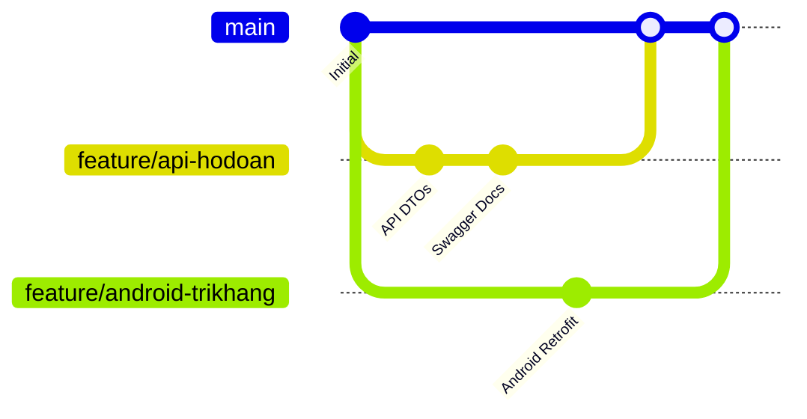

# HƯỚNG DẪN ĐÓNG GÓP MÃ NGUỒN – DỰ ÁN VISIONARY
## VISIONARY ECOSYSTEM – CONTRIBUTING & CODE COLLABORATION GUIDELINES
**Học phần:** Web API (TH71108) – Trường Đại học Công nghệ Đồng Nai (DNTU)
**Nhóm phát triển:** VISIONARY API

---

## 1. QUY TẮC BẢO VỆ NHÁNH CHÍNH (BRANCHING STRATEGY)

Nhánh `main` là nhánh đại diện cho trạng thái triển khai sản xuất (Production Release). Toàn bộ thay đổi của 4 thành viên phải tuân thủ luồng công việc chuẩn:



1. **Không commit trực tiếp lên nhánh `main` đối với tính năng lớn.**
2. **Quy tắc đặt tên nhánh (Branch Naming):**
   - Quách Khoa Đức (Web & Architecture): `feature/web-...` hoặc `chore/ci-...`
   - Đào Trí Khang (Android): `feature/android-...`
   - Hồ Đoàn Nguyên Khang (Web API & Database): `feature/api-...`
   - Võ Ngọc Minh Đạt (Windows Forms & Operations): `feature/winforms-...`

---

## 2. QUY CHUẨN THIẾT LẬP DANH TÍNH GIT (GIT IDENTITY CONFIGURATION)

Trước khi thực hiện bất kỳ commit nào trên máy tính cá nhân, từng thành viên bắt buộc phải cấu hình danh tính Git chính xác với tài khoản GitHub đã được thêm làm Collaborator:

```powershell
# Cấu hình danh tính riêng trên thư mục repository này (Local Scope)
git config user.name "Họ và Tên Của Bạn"
git config user.email "email-github-cua-ban@gmail.com"

# Kiểm tra lại cấu hình
git config user.name
git config user.email
```

> ⚠️ **Nghiêm cấm tuyệt đối:**
> - Không dùng tài khoản của người khác để commit thay.
> - Không commit với email mẫu `your.email@example.com`.
> - Không commit file `.env`, mật khẩu thật hoặc private key.

---

## 3. QUY TRÌNH KIỂM THỬ TRƯỚC KHI TẠO PULL REQUEST (PRE-PR QUALITY GATES)

Trước khi đẩy mã nguồn lên GitHub và tạo Pull Request, thành viên phải bảo đảm toàn bộ các kiểm thử liên quan đều PASS:

### Đối với thay đổi Backend (Web API):
```powershell
dotnet build backend/Visionary.Backend.sln
dotnet test backend/Visionary.Backend.sln
```
*Yêu cầu bắt buộc: 15/15 xUnit tests phải đạt PASS 100%.*

### Đối với thay đổi Frontend (Next.js):
```powershell
cd frontend
npm run build
```
*Yêu cầu: Biên dịch thành công toàn bộ 19 routes không có lỗi TypeScript.*

### Đối với thay đổi Desktop (WinForms):
```powershell
dotnet build desktop/Visionary.Desktop/Visionary.Desktop.csproj
```
*Yêu cầu: 0 lỗi biên dịch.*

---

## 4. QUY TRÌNH REVIEW VÀ MERGE

1. Tạo Pull Request trỏ từ nhánh tính năng (`feature/...`) vào nhánh `main`.
2. Gắn nhãn (labels) tương ứng (`backend`, `frontend`, `desktop`, `mobile`, `docs`).
3. Ít nhất 1 thành viên khác trong nhóm review và xác nhận logic.
4. Toàn bộ GitHub Actions Workflows (Build, Test, Security Audit) chạy thành công.
5. Trưởng nhóm Quách Khoa Đức thực hiện Merge vào nhánh `main`.
