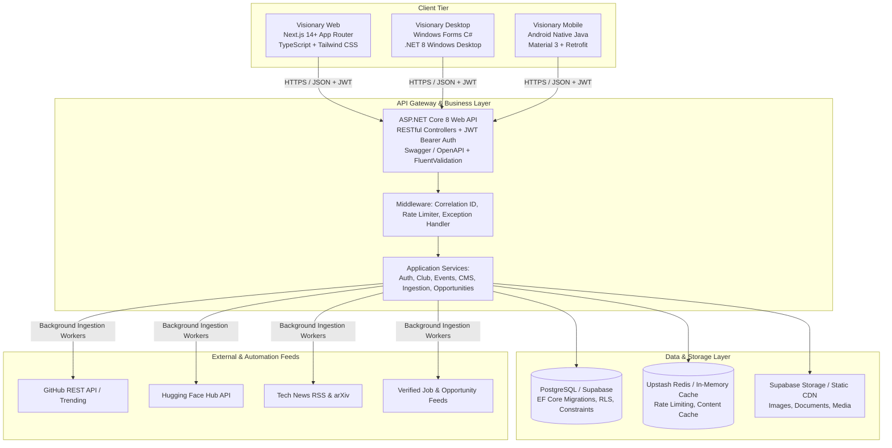

# KIẾN TRÚC HỆ THỐNG VISIONARY (SYSTEM ARCHITECTURE)

## 1. Tổng quan Kiến trúc "Một Backend - Ba Nền tảng" (Unified Architecture)



---

## 2. Phân công Trách nhiệm & Nhận diện Nhóm
- **Tên thương hiệu:** VISIONARY – Hệ thống Quản lý Hoạt động Hội nhập
- **Nhóm phát triển:** VISIONARY API
- **Thành viên:**
  1. **Quách Khoa Đức** (Lead Architect & Full-Stack Engineer): Kiến trúc tổng thể, ASP.NET Core Web API, PostgreSQL/Supabase, Frontend Web, CI/CD và Tự động hóa.
  2. **Võ Ngọc Minh Đạt** (Club Operations & Desktop Engineer): Nghiệp vụ CLB Tiếng Anh, Quản lý Thành viên, Quản lý Sự kiện & Điểm danh, Ứng dụng Windows Forms C#.
  3. **Hồ Đoàn Nguyên Khang** (Data Engineer & Opportunities Specialist): Cổng thông tin cơ hội, Cuộc thi, Học bổng, Career Gateway, Pipeline thu thập và làm sạch dữ liệu.
  4. **Đào Trí Khang** (Mobile Engineer & Tech Lead): Ứng dụng Android Native Java, Chuyên trang English for IT & Technology Radar, Kiểm thử và bảo đảm chất lượng.

---

## 3. Cấu trúc Solution và Mã nguồn (Monorepo Layout)

```text
Visionary API/
├── .agent/                    # Autonomous state, tasks, recovery checkpoints
├── docs/                      # Architectural specifications & documentation
├── backend/
│   ├── Visionary.sln          # Master .NET Solution
│   ├── src/
│   │   ├── Visionary.Core/    # Domain Entities, Enums, Interfaces, DTOs
│   │   ├── Visionary.Infrastructure/ # EF Core DbContext, Repositories, Redis, Services
│   │   └── Visionary.Api/     # ASP.NET Core Controllers, Auth, Middleware, Program.cs
│   └── tests/
│       └── Visionary.Tests/   # Unit and Integration Tests (xUnit, Moq, FluentAssertions)
├── frontend/
│   ├── src/
│   │   ├── app/               # Next.js App Router (Public, Dashboard, CMS, Auth)
│   │   ├── components/        # UI Design System (Shadcn/Tailwind, Header, Footer)
│   │   ├── lib/               # API Client, Auth Helpers, Types, Utilities
│   │   └── styles/            # Global Tailwind CSS and Theme Tokens
│   ├── package.json
│   └── tailwind.config.ts
├── desktop/
│   ├── Visionary.Desktop.sln
│   └── Visionary.Desktop/     # Windows Forms (.NET 8 Windows Desktop)
├── mobile/
│   └── VisionaryAndroid/      # Android Studio Project (Native Java, Gradle, Retrofit)
└── automation/                # Auxiliary scripts & automated data collectors
```

---

## 4. Mô hình Phân quyền Hệ thống (Role-Based Access Control - RBAC)

1. **Guest (Khách vãng lai):** Xem trang chủ, tin tức công khai, danh mục English for IT, Tech Radar, cuộc thi và việc làm công khai.
2. **Registered Student (Sinh viên đã đăng ký):** Đăng nhập bằng Email hoặc Google, xem/sửa thông tin cá nhân, lưu bài viết, lưu cơ hội/việc làm, nộp đơn đăng ký gia nhập CLB Tiếng Anh.
3. **Club Member (Thành viên chính thức CLB):** Đăng ký tham gia sự kiện CLB, xem lịch sinh hoạt nội bộ, điểm danh sự kiện, đề xuất thành tích để vinh danh.
4. **Collaborator (Cộng tác viên nội dung - CTV):** Tạo bài viết mới, gửi bản nháp bài viết English for IT hoặc tin tức, đề xuất nguồn thu thập dữ liệu công nghệ.
5. **Club Committee / BCN (Ban Chủ Nhiệm CLB):** Xét duyệt đơn gia nhập thành viên, quản lý và tổ chức sự kiện, mở điểm danh (QR/thủ công), xem danh sách người tham gia, duyệt bài viết từ CTV, lập báo cáo hoạt động.
6. **Club Supervisor / Lecturer (Giảng viên phụ trách):** Giám sát hoạt động CLB, xem báo cáo thống kê, xác nhận các thành tích học thuật/nghiên cứu.
7. **System Administrator (Quản trị viên hệ thống):** Quản lý toàn bộ người dùng và vai trò, cấu hình hệ thống, quản lý nguồn dữ liệu tự động, xem nhật ký kiểm toán (Audit Logs).
