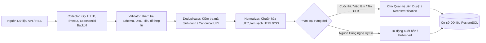

# NGUỒN DỮ LIỆU VÀ TỰ ĐỘNG HÓA (DATA SOURCES & AUTOMATION PIPELINE)

## 1. Nguồn Dữ liệu Chính thống (Official Registered Sources)

1. **GitHub REST API & Trending:**
   - Endpoint: `https://api.github.com/search/repositories`
   - Mục đích: Thu thập kho mã nguồn mở giáo dục chất lượng cao trong các lĩnh vực AI/ML, C#, ASP.NET Core, Next.js, Android, Cybersecurity.
   - Metadata: `full_name`, `description`, `html_url`, `stargazers_count`, `forks_count`, `language`, `topics`, `license.spdx_id`, `updated_at`.
   - Giới hạn: Tôn trọng rate limit (60 requests/giờ không token, 5000 requests/giờ khi có GITHUB_TOKEN). Caching 6 giờ.

2. **Hugging Face Hub API:**
   - Endpoint: `https://huggingface.co/api/models` và `https://huggingface.co/api/datasets`
   - Mục đích: Khám phá các mô hình ngôn ngữ lớn (LLMs), Computer Vision, NLP cho sinh viên nghiên cứu và thực hành AI.
   - Metadata: `id`, `pipeline_tag`, `downloads`, `likes`, `license`, `tags`.
   - Caching: 6 giờ.

3. **arXiv CS Preprints:**
   - Endpoint: `http://export.arxiv.org/api/query?search_query=cat:cs.AI+OR+cat:cs.CL+OR+cat:cs.CV&max_results=20`
   - Mục đích: Bài báo nghiên cứu trí tuệ nhân tạo, xử lý ngôn ngữ tự nhiên dành cho sinh viên nghiên cứu khoa học.

4. **Dev.to / Tech Articles API:**
   - Endpoint: `https://dev.to/api/articles?tag=programming,webdev,ai&per_page=15`
   - Mục đích: Cung cấp bài đọc tiếng Anh chuyên ngành CNTT cập nhật mới nhất để sinh viên vừa luyện đọc vừa học công nghệ.

5. **Cơ hội Cuộc thi & Việc làm (Competitions & Career Opportunities):**
   - Nguồn xác minh từ các cổng cuộc thi học thuật: ICPC Vietnam, Devpost, Kaggle, ASEAN Student Competitions.
   - Tiêu chí: Chỉ lưu các cuộc thi, học bổng hợp pháp, công khai thể lệ và dành cho sinh viên Việt Nam/ASEAN.

---

## 2. Quy trình Xử lý Dữ liệu Chuẩn (Data Processing Lifecycle)

---

## 3. Chính sách Bản quyền & Liêm chính Dữ liệu
- Tuyệt đối không cào dữ liệu (scraping) vượt tường bảo vệ, paywall, hay trái với robots.txt.
- Mọi nội dung thu thập từ bên ngoài đều lưu URL gốc (`OfficialUrl`), tên tác giả/tổ chức, ngày kiểm tra (`LastCheckedAt`), và điều khoản giấy phép (License).
- Không tự bịa đặt thành tích, giải thưởng, thành viên hay giảng viên CLB. Dữ liệu mẫu (Seed Data) dùng cho demo phải được ghi chú rõ ràng là `Demo Environment Data`.
