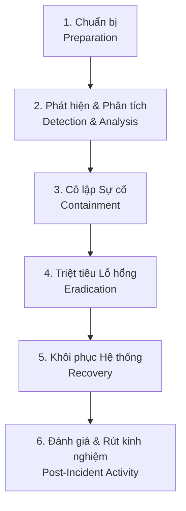

# KẾ HOẠCH VÀ QUY TRÌNH ỨNG PHÓ SỰ CỐ BẢO MẬT (INCIDENT RESPONSE PLAN)
## VISIONARY CYBERSECURITY INCIDENT RESPONSE STANDARD OPERATING PROCEDURE
**Mã dự án:** VISIONARY – Hệ thống Quản lý Hoạt động Hội nhập (TH71108)  
**Tiêu chuẩn áp dụng:** NIST SP 800-61 Rev. 2 (Computer Security Incident Handling Guide)  
**Mục tiêu:** Định nghĩa quy trình phản ứng nhanh khi phát hiện rò rỉ thông tin xác thực, tấn công từ chối dịch vụ hoặc truy cập trái phép.  

---

## 1. ĐỘI NGŨ ỨNG PHÓ SỰ CỐ BẢO MẬT (SIRT - SECURITY INCIDENT RESPONSE TEAM)

- **Trưởng nhóm chỉ huy sự cố (Incident Commander):** Quách Khoa Đức (Chủ sở hữu hệ thống & Lead Architect) – Chịu trách nhiệm ra quyết định cô lập, xoay vòng khóa và truyền thông.
- **Kỹ sư Ứng dụng & Backend (AppSec Lead):** Phụ trách kiểm tra log Web API, rà soát các phiên làm việc JWT và vá lỗi mã nguồn.
- **Kỹ sư Cơ sở dữ liệu (Database Security Lead):** Phụ trách giám sát kết nối Supabase, thực hiện reset password và khôi phục snapshot dữ liệu.
- **Kỹ sư Hạ tầng & Mạng (Cloud/DevSecOps):** Phụ trách kiểm tra cấu hình Vercel, Render và điều chỉnh tường lửa / chặn IP tấn công.

---

## 2. QUY TRÌNH ỨNG PHÓ 6 BƯỚC THEO CHUẨN NIST

### Bước 1: Phát hiện và Nhận diện (Detection & Identification)
- Phát hiện qua công cụ quét (Gitleaks, GitHub Secret Scanning, Dependabot).
- Phát hiện qua nhật ký log máy chủ: Lượng request đột biến, nhiều mã lỗi 401/403 bất thường từ một dải địa chỉ IP lạ.
- Phát hiện do báo cáo từ thành viên nhóm hoặc giảng viên.

### Bước 2: Phân loại Mức độ Khẩn cấp (Triage & Severity Classification)
- **Mức P0 (Khẩn cấp cao nhất):** Rò rỉ thông tin đăng nhập database sản xuất, rò rỉ khóa ký JWT, hoặc phát hiện tài khoản Admin bị chiếm quyền. ➔ **Kích hoạt phản ứng tức thì trong vòng 15 phút.**
- **Mức P1 (Nghiêm trọng):** Phát hiện endpoint bị bypass phân quyền hoặc lộ dữ liệu sinh viên. ➔ **Xử lý trong vòng 2 giờ.**
- **Mức P2 (Trung bình):** Cảnh báo lỗi phụ thuộc thư viện hoặc cấu hình header mạng. ➔ **Xử lý trong vòng 24 giờ.**

### Bước 3: Cô lập Sự cố (Containment)
1. **Đối với sự cố rò rỉ Database Password:**
   - Ngắt kết nối tạm thời hoặc đổi ngay mật khẩu database trên Supabase Console.
2. **Đối với sự cố lộ JWT Secret:**
   - Đổi giá trị `JWT_SECRET` trên Render Dashboard. Việc đổi secret này sẽ lập tức làm vô hiệu hóa toàn bộ các JWT token đang lưu hành của kẻ tấn công.
3. **Đối với tấn công DDoS / Brute-force:**
   - Kích hoạt chế độ "Under Attack Mode" trên Cloudflare / Vercel Edge.
   - Thêm quy tắc chặn IP nguồn tấn công.

### Bước 4: Triệt tiêu Lỗ hổng (Eradication)
- Xóa bỏ chuỗi credential bị rò rỉ khỏi mã nguồn, cấu hình và tài liệu.
- Commit bản vá mã nguồn lên GitHub.
- Cập nhật các file `.dockerignore`, `.gitignore` để ngăn chặn việc tái xuất hiện lỗi.

### Bước 5: Khôi phục và Xác minh (Recovery)
- Redeploy Backend trên Render với cấu hình mới.
- Redeploy Frontend trên Vercel.
- Kiểm tra tính năng xác thực: Đăng nhập thử với tài khoản Admin, BCN, Sinh viên.
- Kiểm tra kết nối cơ sở dữ liệu qua `/health/ready`.
- Giám sát nhật ký log trong 24 giờ tiếp theo để bảo đảm không còn truy cập bất thường.

### Bước 6: Tổng kết và Rút kinh nghiệm (Post-Incident Review)
- Lập biên bản sự cố, lưu lại nguyên nhân gốc (Root Cause Analysis - RCA).
- Bổ sung các rule kiểm tra tự động vào quy trình CI/CD để ngăn chặn lỗi tương tự trong tương lai.
