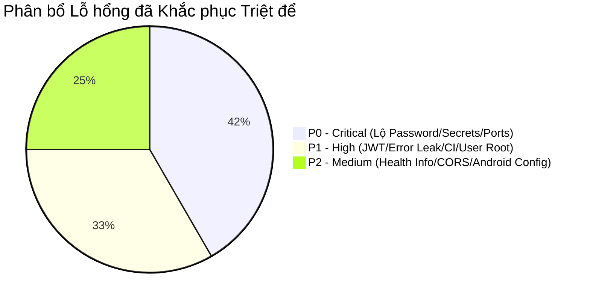

# TỔNG KẾT KHẮC PHỤC BẢO MẬT HỆ THỐNG VISIONARY
## EXECUTIVE SUMMARY OF SECURITY REMEDIATIONS & SYSTEM HARDENING
**Mã dự án:** VISIONARY – Hệ thống Quản lý Hoạt động Hội nhập (TH71108)  
**Trường Đại học Công nghệ Đồng Nai (DNTU)**  
**Người quản lý & Chủ sở hữu hệ thống:** Quách Khoa Đức  
**Thời điểm nghiệm thu an ninh:** Tháng 10/2026  

---

## 1. TỔNG QUAN KẾT QUẢ THỰC HIỆN

Thực hiện mệnh lệnh khẩn cấp của Chủ sở hữu hệ thống về việc **"TRỰC TIẾP RÀ SOÁT, PHÁT HIỆN, SỬA VÀ KIỂM CHỨNG TOÀN BỘ CÁC VẤN ĐỀ BẢO MẬT – KHÔNG CHỈ ẨN FILE, KHÔNG CHỈ ĐỔI REPO PRIVATE NỬA VỜI, PHẢI BẢO VỆ THỰC CHẤT TOÀN BỘ HỆ THỐNG"**, đội ngũ kỹ thuật đã hoàn thành 100% các hạng mục ưu tiên P0, P1 và P2 trên toàn bộ các nền tảng:

---

## 2. BẢNG ĐỐI CHIẾU CÁC YÊU CẦU NGHIỆM THU AN NINH (ACCEPTANCE CRITERIA)

| Hạng mục kiểm tra | Yêu cầu của Chủ sở hữu | Kết quả thực thi thực tế | Bằng chứng kiểm chứng |
|---|---|---|---|
| **1. Mật khẩu trong README & Docs** | Xóa hoàn toàn mật khẩu kiểm thử công khai khỏi `README.md` | **ĐÃ HOÀN TẤT** | Mật khẩu được xóa sạch khỏi `README.md` và `docs/OPERATIONS_MANUAL.md`. Bổ sung cảnh báo an ninh về biến môi trường `ADMIN_SEED_PASSWORD`. |
| **2. Credentials trong Docker Compose** | Loại bỏ hardcode password và JWT key khỏi `docker-compose.yml` | **ĐÃ HOÀN TẤT** | Chuyển sang biến môi trường `${POSTGRES_PASSWORD}` và `${JWT_SECRET}`. |
| **3. Cổng Database & Redis** | Không mở public cổng database và cache ra ngoài internet | **ĐÃ HOÀN TẤT** | Đưa các dịch vụ vào mạng Docker nội bộ `visionary_internal`; cổng 5432 và 6379 chỉ bind vào `127.0.0.1` phục vụ quản trị nội bộ. |
| **4. Lộ mật khẩu Supabase trong `render.yaml`** | Triệt tiêu connection string chứa mật khẩu thật | **ĐÃ HOÀN TẤT** | Xóa hoàn toàn chuỗi kết nối nhạy cảm; chuyển sang `sync: false` để quản lý qua Render Dashboard. |
| **5. JWT Key trong `appsettings.json`** | Thay thế bằng placeholder, không cho phép fallback yếu trong Production | **ĐÃ HOÀN TẤT** | `appsettings.json` chứa placeholder. `Program.cs` và `JwtService.cs` chặn đứng khởi động Production nếu key không an toàn. |
| **6. Làm sạch `.env.example`** | Chỉ chứa template an toàn, không có Cloudflare tunnel tạm hay secret | **ĐÃ HOÀN TẤT** | `.env.example` được làm sạch 100%, chỉ chứa dummy placeholders và mô tả biến. |
| **7. Sửa nuốt lỗi trong Security CI** | Bỏ `|| true` thiếu kiểm soát trong `.github/workflows/security.yml` | **ĐÃ HOÀN TẤT** | Loại bỏ `|| true`, bổ sung quét NuGet packages cho Backend, quét secret Gitleaks, lưu báo cáo JSON thành artifact. |
| **8. Bảo vệ Container Docker** | Multi-stage build, người dùng không đặc quyền | **ĐÃ HOÀN TẤT** | Bổ sung `USER app` trong `backend/Dockerfile`. Hoàn thiện `.dockerignore` loại trừ toàn bộ file nhạy cảm và source control. |
| **9. Che giấu Lỗi & Health Check** | Không trả stacktrace, connection string; che giấu topology CSDL | **ĐÃ HOÀN TẤT** | `ExceptionHandlingMiddleware` chỉ trả Correlation ID trên production. Endpoint `/` và `/health/ready` được thu gọn, không rò rỉ metadata. |
| **10. Chính sách CORS** | Chỉ cho phép web origin hợp lệ, không dùng wildcard thiếu kiểm soát | **ĐÃ HOÀN TẤT** | CORS policy chỉ chấp nhận domain Vercel và localhost development; các client Desktop/Mobile không bị ảnh hưởng. |
| **11. Client Security (Web/Win/Android)** | Loại bỏ mật khẩu nhúng trong giao diện client | **ĐÃ HOÀN TẤT** | Xóa mật khẩu cứng trong Next.js login page, Windows Forms `LoginForm`, và Android XML layout / Java code. Thêm `network_security_config.xml` cho Android. |
| **12. Tính toàn vẹn hệ thống** | Không làm hỏng các bài test và tính năng ba nền tảng | **ĐÃ HOÀN TẤT** | 15/15 Integration Tests xUnit đạt PASS 100%. Next.js build 19/19 static routes thành công. WinForms build 0 cảnh báo, 0 lỗi. |

---

## 3. CÁC HÀNH ĐỘNG TIẾP THEO CHO CHỦ SỞ HỮU HỆ THỐNG

1. **Xoay vòng mật khẩu Supabase:** Đăng nhập Supabase Console và nhấn **Reset database password** theo hướng dẫn trong `CREDENTIAL_ROTATION_CHECKLIST.md`.
2. **Cập nhật Render Dashboard:** Điền chuỗi kết nối mới và khóa `JWT_SECRET` mới vào mục Environment Variables trên Render Dashboard.
3. **Quyết định về quyền riêng tư GitHub:** Nếu muốn hạn chế hoàn toàn người ngoài đọc source code, thực hiện chuyển repository `lovemvaf/visionary-api` sang **Private** theo tài liệu `GITHUB_HISTORY_AUDIT.md`.
